<p align="center">
  
</p>

<table>
  <tr>
    <td width="35%" align="center" valign="middle">
      
    </td>
    <td width="65%" valign="middle">
      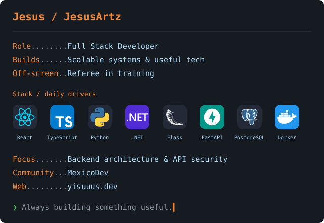
    </td>
  </tr>
</table>

<p align="center">
  <a href="https://yisuuus.dev/"></a>
  <a href="https://www.linkedin.com/in/jesusartz/">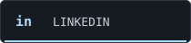</a>
  <a href="https://github.com/JesusArtz?tab=repositories"></a>
</p>

### `~/projects`

**LeagueUp** → A management system for sports leagues.<br />
**HackOnLinces Platform** → Event management for participants, judges and mentors.

### `~/now`

```text
> Building better backend architecture with .NET.
> Working on API security: rate limiting, authentication and scaling.
> Connecting with developers through MexicoDev.
```

### `~/stack`

#### Languages

<p>
  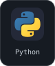
  
  
  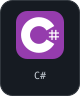
  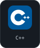
  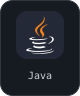
  
  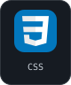
</p>

#### Web & UI

<p>
  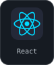
  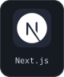
  
  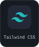
  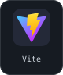
  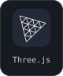
</p>

#### Backend & APIs

<p>
  
  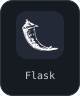
  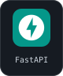
  
  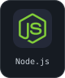
  
  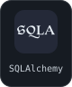
</p>

#### Mobile & native

<p>
  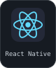
  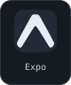
  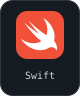
  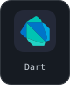
  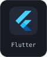
</p>

#### Databases

<p>
  
  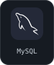
  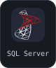
  
  
</p>

#### DevOps & tools

<p>
  
  
  
  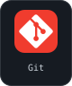
  
  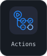
  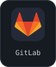
  
</p>

#### Testing, science & hardware

<p>
  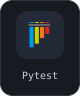
  
  
  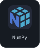
  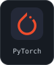
  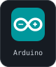
  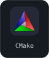
</p>

### `~/activity`

<p align="center">
  <a href="https://github.com/JesusArtz"></a>
</p>

<p align="center">
  <a href="https://mexicodev.org/">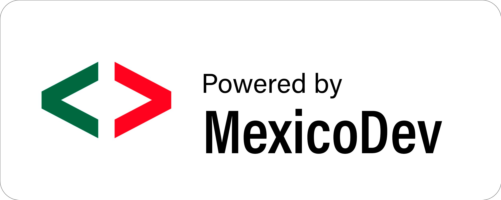</a>
  <br />
  <sub>Code, football discipline, and systems thinking.</sub>
</p>
